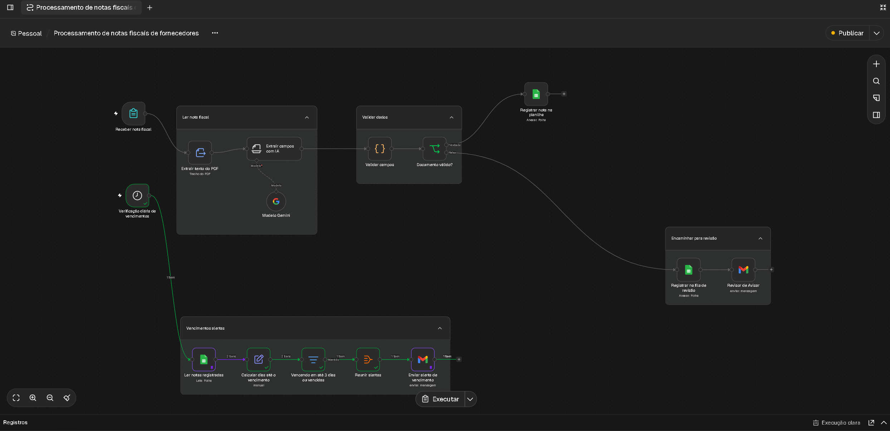

# AI Flow — Automação de Processamento de Notas Fiscais

## Visão geral

O AI Flow é um fluxo de automação desenvolvido com n8n para apoiar o controle administrativo e financeiro de notas fiscais de fornecedores.

O projeto utiliza inteligência artificial para extrair informações de documentos fiscais, aplica validações para reduzir inconsistências e direciona os registros para os destinos adequados. Também realiza verificações diárias de vencimentos e envia alertas por e-mail.

### Visão geral do workflow



## Objetivos

- Automatizar a leitura e o processamento de notas fiscais.
- Reduzir tarefas manuais no registro de documentos.
- Identificar informações ausentes ou inconsistentes.
- Encaminhar documentos que precisam de conferência humana.
- Acompanhar vencimentos e sinalizar pagamentos próximos ou atrasados.

## Como funciona

### 1. Recebimento da nota fiscal
O fluxo recebe o documento fiscal em PDF por meio de um formulário.

### 2. Extração de informações com IA
O documento é processado para extrair seu texto e identificar campos relevantes, utilizando o modelo Gemini.

### 3. Validação dos dados
Uma etapa de validação verifica os campos extraídos antes de permitir o registro.

### 4. Direcionamento dos documentos
- **Documentos válidos:** seguem para registro na planilha.
- **Documentos com problemas:** são encaminhados para uma fila de revisão, com notificação ao responsável.

### 5. Monitoramento de vencimentos
Uma rotina diária consulta os registros, calcula os dias até o vencimento e identifica notas não pagas que estão vencendo em até três dias ou já estão vencidas.

### 6. Envio de alertas
Os alertas identificados são reunidos e enviados por e-mail.

## Tecnologias utilizadas

- **n8n:** criação e execução dos fluxos de automação.
- **Google Gemini:** extração de informações dos documentos com inteligência artificial.
- **Google Sheets:** armazenamento e consulta dos registros.
- **Gmail:** envio de notificações e alertas.
- **PDF:** formato dos documentos recebidos.

## Testes e demonstrações

O projeto conta com evidências visuais e gravações demonstrando:

- Visão geral do workflow.
- Processamento de notas fiscais.
- Monitoramento e alertas de vencimento.
- Testes de processamento e de envio de alertas.

Os materiais estão disponíveis na pasta `02-evidencias`.

## Estrutura do projeto

```text
Ai Flow/
├── README.md
├── 01- workflow/
│   └── AI_Flow_publico_v2.json
└── 02-evidencias/
    ├── prints/
    └── videos/
```

**Observação:** o backup privado não deve ser publicado no GitHub.

## Segurança e privacidade

A versão pública do workflow foi preparada para compartilhamento, com a substituição de identificadores e informações privadas por marcadores genéricos.

Para utilizar o workflow após importá-lo no n8n, será necessário:

- Configurar as credenciais próprias do Google Gemini, Google Sheets e Gmail.

- Informar o ID da planilha Google Sheets que será utilizada.

- Configurar o endereço de e-mail de destino das notificações.

- Conferir as configurações e testar as etapas antes de ativar a automação.

As credenciais e chaves de API não estão incluídas no arquivo público. Dados pessoais, identificadores privados e informações de acesso não devem ser compartilhados no repositório.

## Finalidade do projeto

O AI Flow integra automação de processos, inteligência artificial e organização de informações financeiras, demonstrando como essas tecnologias podem apoiar rotinas administrativas e operacionais.
